# Tests dans les simulateurs iPhone + Apple Watch

Le workflow GitHub Actions **Simulateurs** (`.github/workflows/simulator.yml`) :
1. compile l'app iPhone (avec l'app Watch embarquée) pour le simulateur ;
2. crée un iPhone et une Apple Watch simulés **appairés**, installe les deux apps ;
3. exécute les scénarios de `scripts/sim/scenarios.json` (lancements avec arguments, captures,
   rapports JSON écrits par les apps, vérifications) ;
4. publie captures, rapports et `RESULTATS.md` sur la branche `ci-sim-results`.

Sur votre Mac (Xcode installé) :

```bash
xcodebuild -project Foulee.xcodeproj -scheme Foulee -destination 'generic/platform=iOS Simulator' \
  -derivedDataPath build/dd CODE_SIGN_STYLE=Manual CODE_SIGN_IDENTITY=- DEVELOPMENT_TEAM= build
python3 scripts/sim/run_scenarios.py build/dd/Build/Products/Debug-iphonesimulator/Foulee.app sim-out
open sim-out/RESULTATS.md
```

## Mode scénario (sans effet en usage normal)

Activé uniquement par l'argument `-FouleeScenario`. iPhone : tapis simulé, pas de demande Santé,
zones de test (FC max 185, repos 60 → Z2 = 135–148 bpm), programmes courts « Test Zone 2 Auto »
(30 s + 5 min pilotées + 30 s) et « Test enchaînement », FC simulée dépendant de la vitesse
(`-FouleeSimHR`), script d'actions (`-FouleeScript "pause@45,resume@60,linkloss@95,…"`).
Watch : exercice simulé sans HealthKit (`-FouleeSimulated`) dont la FC, calculée depuis la vitesse
reçue de l'iPhone, part par le **même chemin WatchConnectivity** qu'une vraie mesure ;
`-FouleeAutoStart <programme>` reproduit « choisir → Démarrer → confirmer ».

## Ce que le simulateur ne permet pas de vérifier

- le Bluetooth FTMS réel et le comportement du tapis URTM047 ;
- le capteur cardiaque de la montre et une ceinture Bluetooth réelle ;
- le miroir d'exercice HealthKit (`startMirroringToCompanionDevice`) et l'enregistrement Santé :
  dans les scénarios, la montre passe par WatchConnectivity ;
- l'arrière-plan (écran verrouillé, app suspendue), la portée Bluetooth/Wi-Fi entre les appareils.

## Résultats (simulateurs iPhone 17 Pro iOS 26.2 + Apple Watch Series 10 watchOS 26.2, appairés)

Détail de chaque vérification : [captures/RESULTATS_SIMULATEURS.md](captures/RESULTATS_SIMULATEURS.md).

| Scénario | Ce qui est vérifié | Résultat |
|---|---|---|
| 01 Écrans iPhone | lancement, 4 onglets, éditeur (Zone 2 Auto, Baseline verrouillé), sombre, clair, très grand texte | OK, aucun crash |
| 02 Zone 2 Auto (FC simulée) | rampe, accélérations par 0,2 km/h ≥ 60 s, perte de FC 45 s → alerte et ralentissement progressif, reprise manuelle prioritaire puis réactivation, ≤ 7 km/h | OK |
| 03 Pause / déconnexion | paliers 4→5→6→7 et 7→6→5, pause/reprise, coupure Bluetooth → pause, reconnexion → reste en pause, aucun Start ni accélération automatique | OK |
| 04 Lancement depuis la Watch | demande Watch → iPhone, tapis démarré, FC de la Watch utilisée par le pilote, état en direct sur la Watch, pause, reprise et arrêt depuis la Watch, fin des deux côtés | OK dans 3 passages sur 5 (dont le passage de référence : 18/18 vérifications) — voir ci-dessous |
| 05 Écrans Watch | catalogue de l'iPhone sur la montre (9 programmes), détails, pages de séance | OK (une relance d'app refusée une fois par le simulateur, « Scene update failed ») |

**Fiabilité du lien Watch ↔ iPhone dans le simulateur.** Sur 5 passages du scénario 04 : 3 réussis
intégralement ; 1 où le simulateur a transmis la demande de démarrage avec 58 s de retard
(l'iPhone l'a refusée comme trop ancienne et la montre a annoncé « rien n'a démarré » : le
comportement de sécurité attendu) ; 1 où le lien WatchConnectivity ne s'est jamais établi
(iPhone « injoignable » pendant 120 s alors que l'app iPhone était au premier plan). Ces deux
échecs viennent de l'infrastructure des simulateurs appairés ; à confirmer sur vos appareils, où
le lien passe en plus par le miroir d'exercice HealthKit.

Problèmes trouvés grâce à ces tests et corrigés : paliers de vitesse trop courts, graphiques de
programme empilés, mode clair illisible, carte d'accueil cassée en très grand texte,
synchronisation dépendante de l'envoi par l'iPhone (désormais la montre réclame aussi l'état),
ralentissements de sécurité intempestifs sur une FC Watch retardée (délai de grâce 15 s),
incohérence des délais de démarrage depuis la montre, reprise refusée sans explication sur la montre.

## Captures

| iPhone | | |
|---|---|---|
| 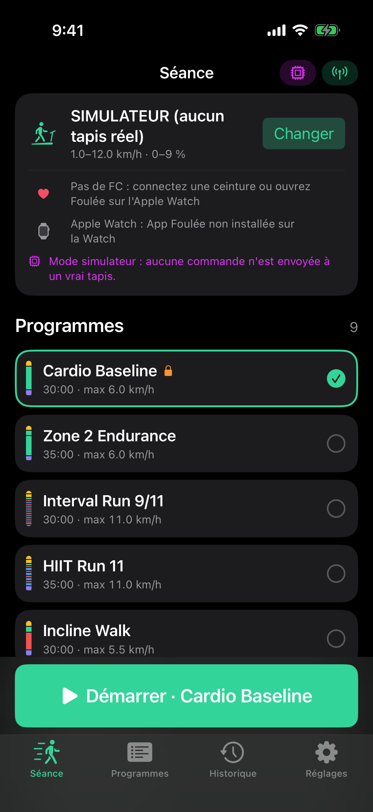 | 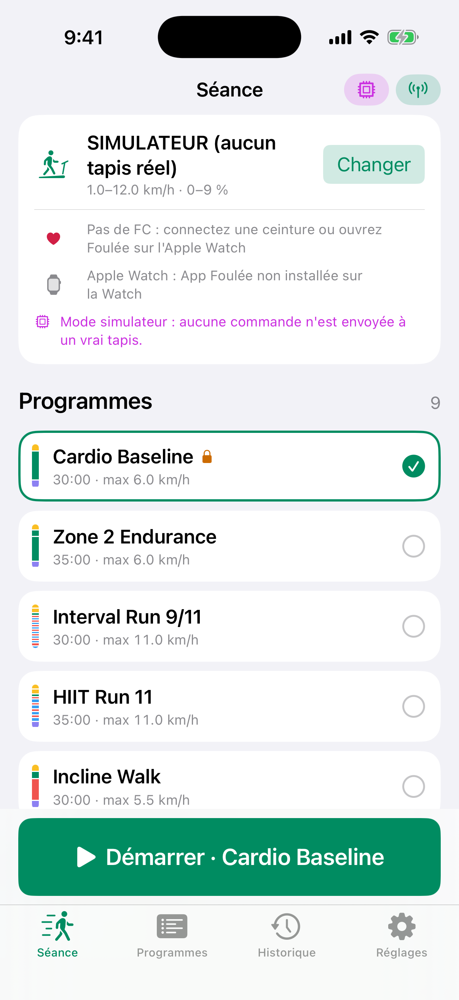 | 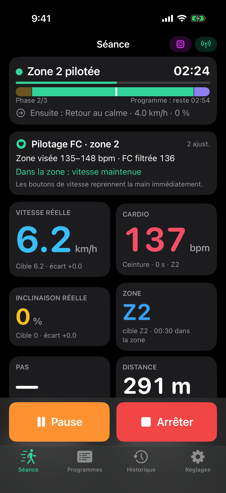 |
| 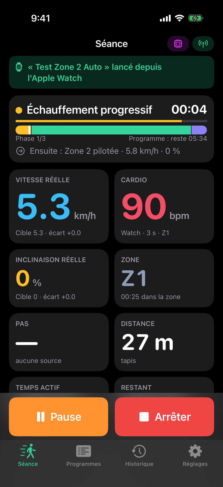 | 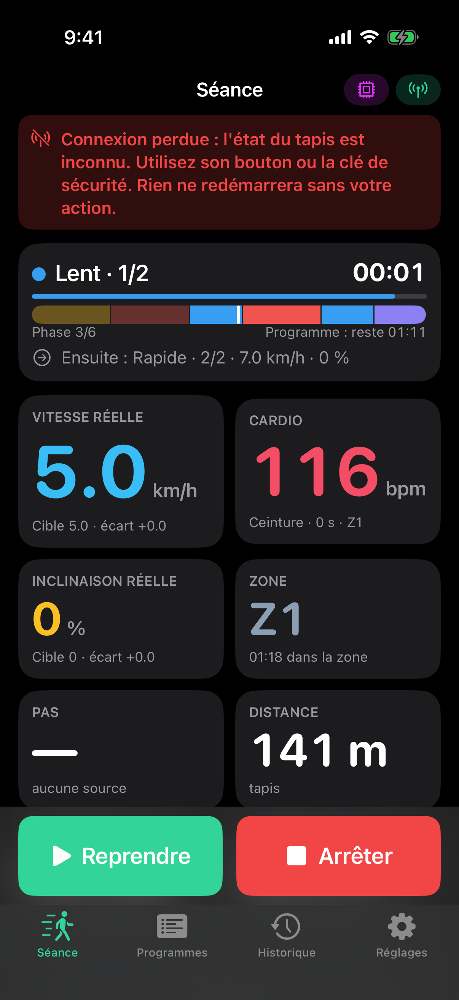 | 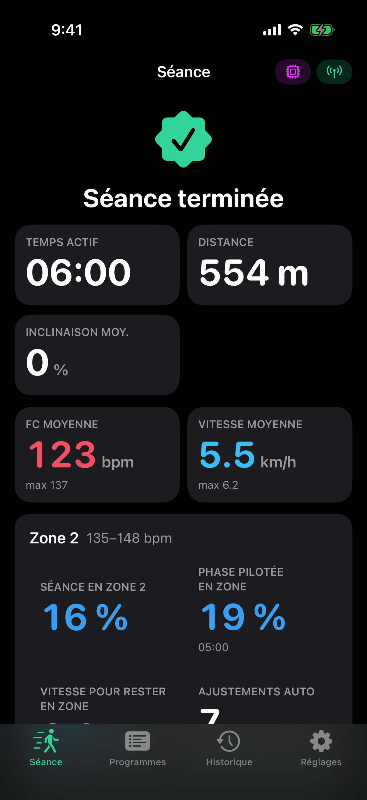 |

| Apple Watch | | | |
|---|---|---|---|
| 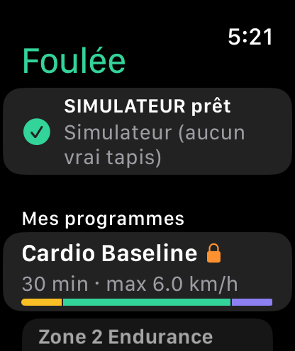 | 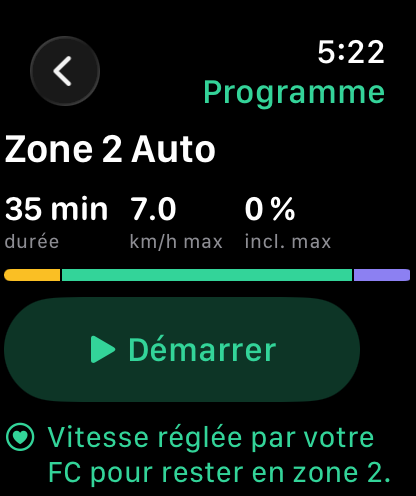 | 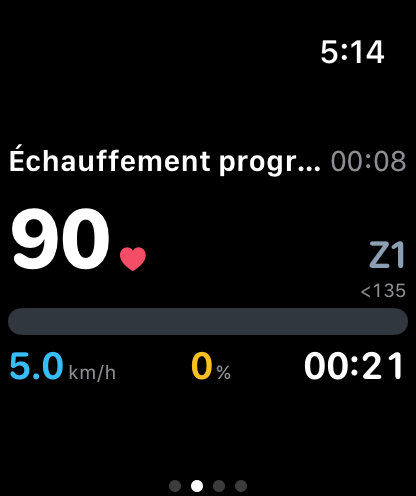 | 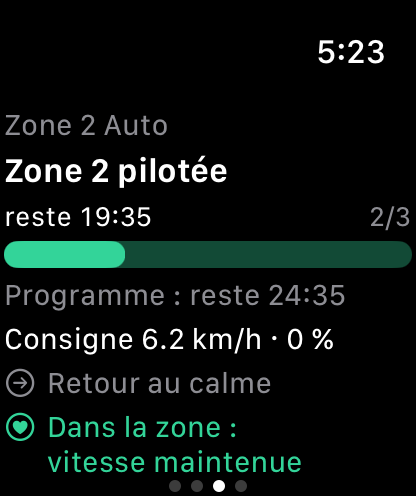 |
| 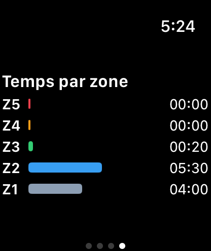 | 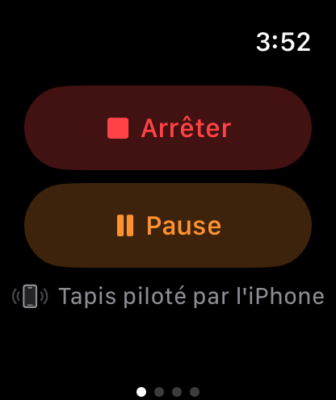 | 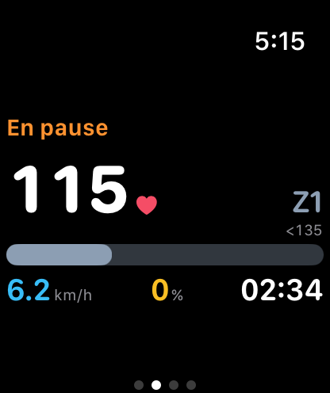 | 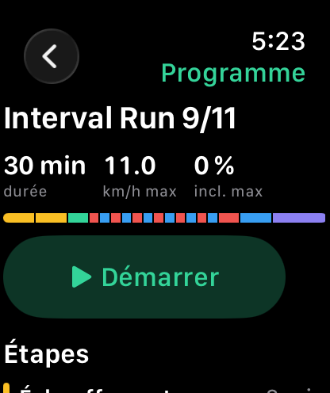 |
